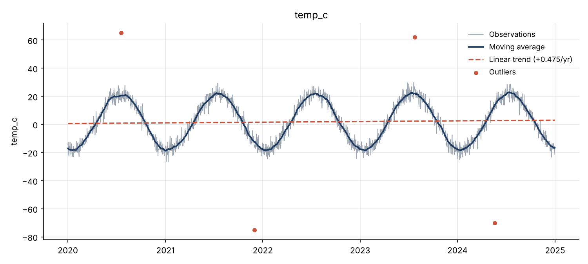
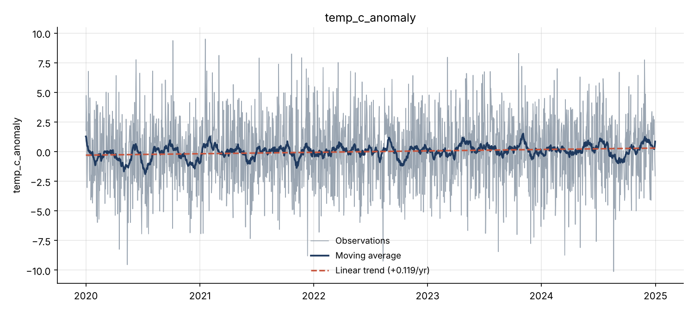

# tsanalyzer

[](https://github.com/aseka49/tsanalyzer/actions/workflows/ci.yml)


[](LICENSE)


A small, tested Python toolkit for exploratory analysis of **scientific time series**
(meteorological, environmental, sensor or experimental measurements). It turns a raw CSV
file into a cleaned series, a JSON report of statistics and trends, and a publication-ready figure.



## Features

| Step | Function | Methods |
|---|---|---|
| Load | `load_csv` | Any date/value columns, custom separator, duplicate timestamps averaged |
| Fill gaps | `fill_missing` | Time-weighted linear interpolation, forward/backward fill, drop |
| Outliers | `remove_outliers` | Tukey IQR fences, z-score |
| Seasonality | `deseasonalize` | Anomalies from monthly or day-of-year climatology |
| Resample | `resample` | Any pandas frequency (`W`, `MS`, `YS`…) with mean/sum/min/max/median |
| Statistics | `describe`, `autocorrelation` | Mean, std, quartiles, skewness, kurtosis, lag-k autocorrelation |
| Trend | `linear_trend`, `mann_kendall`, `moving_average` | OLS slope with R² and p-value, non-parametric Mann–Kendall test |
| Plot | `plot_series` | Observations, moving average, trend line, highlighted outliers |

## Installation

```bash
git clone https://github.com/aseka49/tsanalyzer.git
cd tsanalyzer
python -m venv .venv && source .venv/bin/activate   # Windows: .venv\Scripts\activate
pip install -e ".[dev]"
```

## Quick start

### Command line

```bash
tsanalyzer examples/temperature.csv --value-col temp_c \
    --deseasonalize dayofyear --window 30 \
    --plot out/anomalies.png --report out/report.json
```

Key options: `--fill {linear,ffill,bfill,drop}`, `--outliers {iqr,zscore,none}`,
`--threshold`, `--resample W`, `--deseasonalize {month,dayofyear}`, `--window N`.
Run `tsanalyzer --help` for the full list.

### HTTP API

```bash
tsanalyzer-server --port 8000          # or run the Docker image, see below
curl http://localhost:8000/health
curl --data-binary @examples/temperature.csv \
     "http://localhost:8000/analyze?value_col=temp_c&deseasonalize=dayofyear"
```

`POST /analyze` takes the CSV file as the request body and the CLI options as query parameters
(`time_col`, `value_col`, `fill`, `outliers`, `threshold`, `resample`, `deseasonalize`) and returns the
same JSON report as the command line. Errors return `400` (bad parameters), `422` (bad data) or `413` (> 10 MB).

### Python API

```python
from tsanalyzer import load_csv, fill_missing, remove_outliers, deseasonalize, linear_trend, mann_kendall

s = load_csv("examples/temperature.csv", value_col="temp_c")
s = fill_missing(s, "linear")
s, outliers = remove_outliers(s, "iqr")
anomalies = deseasonalize(s, "dayofyear")

print(linear_trend(anomalies).slope_per_year)  # °C per year
print(mann_kendall(anomalies)["trend"])  # 'increasing'
```

## Example: why deseasonalising matters

`examples/temperature.csv` is a **synthetic** daily temperature series (2020–2024) generated with a known
warming trend of **+0.15 °C/year**, a strong seasonal cycle, random noise, 40 missing days and 4 sensor
glitches. It is used to demonstrate and test the methods.

| Analysis | Estimated trend | OLS p-value | Mann–Kendall |
|---|---|---|---|
| Raw daily values | +0.475 °C/yr (≈ 3× too high) | 0.046 | p = 0.035 |
| Day-of-year anomalies | **+0.119 °C/yr** | 0.011 | **p = 0.003** |

The seasonal cycle biases a straight-line fit on raw data; removing the climatology
recovers a value close to the true trend and makes the test much more confident.



## Docker

The [Dockerfile](Dockerfile) has two targets: `test` (dev tools and tests, used by CI) and `runtime`
(the default: a small image that runs the HTTP API as a non-root user, with a health check).

```bash
docker build -t tsanalyzer .
docker run -d --name tsanalyzer -p 8000:8000 tsanalyzer       # API on http://localhost:8000
docker run --rm --entrypoint tsanalyzer tsanalyzer examples/temperature.csv --value-col temp_c   # CLI
docker build --target test -t tsanalyzer-test . && docker run --rm tsanalyzer-test               # tests
```

## CI/CD with Jenkins

The [Jenkinsfile](Jenkinsfile) defines the pipeline. Every stage runs in Docker:

| Stage | What happens |
|---|---|
| Build test image | `docker build --target test` |
| Lint | `ruff check` and `ruff format --check` inside the test image |
| Unit tests | `pytest` with coverage; JUnit and coverage reports are published in Jenkins |
| Build image | `docker build --target runtime`, tagged `<version>-<build>-<commit>` and `latest` |
| Smoke test | starts the container, waits for `healthy`, analyses the example file through the API |
| Push to Docker Hub | only when Docker Hub credentials are configured |
| Deploy to staging (CD) | replaces the `tsanalyzer-staging` container on port 8000 |
| Deploy to Kubernetes (CD, optional) | `kubectl apply` + rolling update, enabled with the `DEPLOY_K8S` parameter |

The job polls GitHub every ~2 minutes, so every commit to `main` is built automatically.

### Run Jenkins locally (Docker Desktop on Windows/macOS, or Docker on Linux)

```bash
cd jenkins
cp .env.example .env          # Windows: copy .env.example .env  — then set a password (and Docker Hub token)
docker compose up -d --build  # first start downloads Jenkins and plugins (~5 min)
```

Open <http://localhost:8080> and log in (default `admin` / `admin123`). The **tsanalyzer CI/CD** job is
created automatically from [jenkins/casc.yaml](jenkins/casc.yaml) (Configuration as Code + Job DSL) and
starts its first build within two minutes. After a green build the staging API answers on
<http://localhost:8000/health>.

### Optional: deploy to Minikube

```bash
minikube start
minikube image load tsanalyzer:latest      # or push to Docker Hub and use <user>/tsanalyzer
kubectl apply -f k8s/
kubectl rollout status deployment/tsanalyzer
minikube service tsanalyzer --url          # then open <url>/health
```

To let Jenkins do this, add a *Secret file* credential with id `kubeconfig` and run the job with
**Build with Parameters → DEPLOY_K8S**.

## Development

```bash
pytest                      # run the test suite (58 tests)
pytest --cov                # with coverage (CI requires ≥ 85 %)
ruff check . && ruff format --check .
```

Two CI systems run the same checks: Jenkins (above) and GitHub Actions. GitHub Actions (`.github/workflows/ci.yml`) runs linting, the test suite on Python 3.11–3.14
(plus Windows and macOS), a CLI smoke test and a package build on every push and pull request.
Pushing a version tag (`git tag v1.0.0 && git push --tags`) triggers `.github/workflows/release.yml`,
which builds the package and publishes a GitHub Release.

See [CONTRIBUTING.md](CONTRIBUTING.md) for the branching and commit conventions.

## Project structure

```
src/tsanalyzer/     package source (io, cleaning, stats, trend, plotting, cli, server)
tests/              unit, CLI and HTTP API tests
examples/           sample dataset
docs/               figures and example reports
.github/            GitHub Actions workflows, issue and PR templates
Dockerfile          multi-stage image (test / runtime)
Jenkinsfile         Jenkins CI/CD pipeline
jenkins/            ready-to-run Jenkins server (Docker Compose + Configuration as Code)
k8s/                Kubernetes Deployment and Service
```

## Citation

If you use this tool in academic work, please cite it using the metadata in [CITATION.cff](CITATION.cff).

## License

Released under the [MIT License](LICENSE).

test
test 2.0
